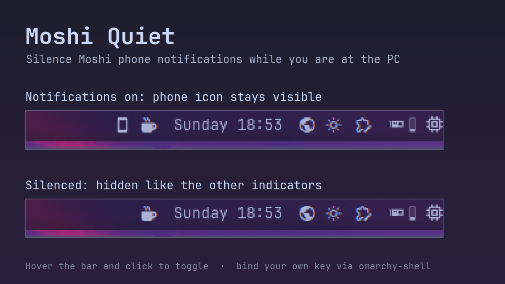

# Moshi Quiet

An [Omarchy](https://omarchy.org) bar widget that silences [Moshi](https://getmoshi.app) phone notifications while you are at the computer.



## Why

[moshi-hook](https://getmoshi.app/docs/hooks) sends a push to your phone every time a coding agent (Pi, Claude Code, Codex, ...) finishes a turn. That is great when you are away, and noise when you are sitting at the desk.

moshi-hook can already mute pushes while the screen is unlocked, but only on macOS (`suppress-push-while-unlocked`). Its `suppress-push-without-mux` setting does not help either when you run your agents inside tmux, zellij or herdr on the desktop. This widget gives Linux users a one-click switch instead.

## How it works

The widget starts and stops the `moshi-hook.service` systemd user unit. When the daemon is not running, the agent hooks fail silently and nothing reaches your phone. No moshi-hook or agent files are modified, so moshi-hook updates do not break it.

It behaves like the built-in Omarchy indicators next to it:

| State | Bar |
| --- | --- |
| Notifications on (service active) | Phone icon, always visible |
| Notifications off (service stopped) | Hidden; a dimmed crossed-out icon appears while the pointer is on the bar |
| moshi-hook not installed | Hidden; on hover the tooltip says so, and clicking opens the install guide |

Click the icon to toggle. If `systemctl` fails, a desktop notification shows the error.

> While silenced, everything that needs the daemon stops too: Moshi's Chat View, phone approvals and usage sync. SSH/Mosh access from the phone keeps working, so you can turn notifications back on remotely with the IPC command below.

## Requirements

- Omarchy with the Quickshell-based Omarchy shell
- [moshi-hook](https://getmoshi.app/docs/install-moshi-hook) installed as the `moshi-hook.service` **systemd user** unit (the default on Linux)
- `notify-send` for error notifications and `xdg-open` for the install link (both ship with Omarchy)

## Install

```bash
omarchy plugin add https://github.com/IamFranP13/omarchy-moshi-quiet
omarchy plugin enable io.github.iamfranp13.moshi-quiet --before omarchy.indicators
```

The second command puts it right before the built-in indicators (stay awake, night light, ...) in the `centerBegin` section, where it looks like one of them. Any other placement works too, for example:

```bash
omarchy bar move io.github.iamfranp13.moshi-quiet --section right --index 0
```

## Settings

| Key | Default | Meaning |
| --- | --- | --- |
| `persistAcrossReboot` | `true` | `true`: silencing also disables the service's autostart (`systemctl --user disable --now`), so it stays silent after a reboot. `false`: it only stops the service, and notifications come back after a reboot. |

```bash
omarchy bar set io.github.iamfranp13.moshi-quiet persistAcrossReboot false --json
```

Turning notifications on always runs `systemctl --user enable --now moshi-hook.service`.

## Keyboard shortcut

None is set up for you. Bind any key you like to the IPC command, for example in `~/.config/hypr/bindings.lua`:

```bash
omarchy-shell io.github.iamfranp13.moshi-quiet toggle    # also: enable, disable, refresh
```

## Remove

```bash
omarchy plugin remove io.github.iamfranp13.moshi-quiet
```

Removing the widget does not change the service. If you left notifications off, turn them back on with:

```bash
systemctl --user enable --now moshi-hook.service
```

## Translations

Tooltips and messages are in `i18n/` (English and Spanish). Pull requests with other languages are welcome.

## License

[MIT](LICENSE)
